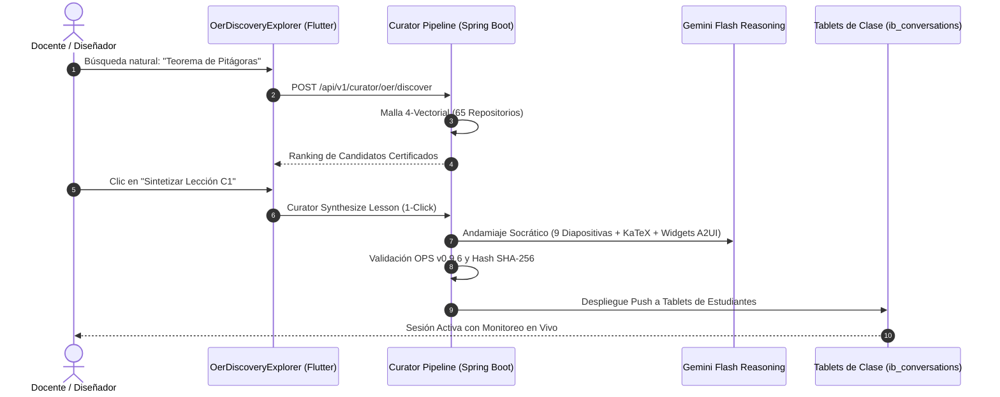

import { Aside, Card, CardGrid } from '@astrojs/starlight/components';
import FlutterDemo from '../../../../components/FlutterDemo.astro';

# Explorador Planetario OER Interactivo

El **Explorador Planetario OER A2UI** conecta a docentes y diseñadores curriculares con la red soberana de **65 repositorios oficiales de 52 países**. A diferencia de los motores de búsqueda comerciales o agregadores estáticos, evalúa cada recurso mediante una **matriz multicriterio de 4 vectores** y permite **sintetizar lecciones socráticas interactivas (OPS C1) y asignarlas al aula en menos de 30 segundos**.

---

## Demostración Interactiva en Vivo

Interactúa directamente con el motor A2UI compilado en WebAssembly. Puedes filtrar por pilares soberanos, explorar métricas de calidad y simular la síntesis curricular inmediata:

<FlutterDemo 
  route="/embed/oer-explorer?framework=GLOBAL" 
  title="Explorador Planetario OER A2UI" 
  height="720px" 
/>

<Aside type="tip">
  En la aplicación real (`ib_conversations`), este mismo widget opera de forma omnicanal: se despliega como **panel lateral asistente** (`companionSidecar`) en chats pedagógicos, como **ventana modal de asignación** para profesores (`teacherModal`), o como **iframe web embebido** en portales públicos.
</Aside>

---

## Los 4 Pilares de la Red Soberana OER

El explorador clasifica dinámicamente los recursos indexados en cuatro categorías operativas:

<CardGrid stagger>
  <Card title="1. Canónicos Oficiales" icon="seti:certificate">
    Plataformas avaladas por ministerios nacionales: **Proyecto EDIA / Cedec-INTEF** (España), **OpenStax / Rice University** (EE.UU.), **Educ.ar** (Argentina), **Canal Ceibal** (Uruguay), **OpenLearn / Open University** (Reino Unido).
  </Card>
  <Card title="2. Regionales & Autonómicos" icon="seti:folder">
    Repositorios contextualizados territorialmente: **CREA Andalucía**, **Agrega2**, **Guadalinex/Mestreacasa**, **SEDMX** (México), bibliotecas de comunidades autónomas y distritos escolares.
  </Card>
  <Card title="3. Multimodales & Simulaciones" icon="seti:video">
    Laboratorios interactivos y medios enriquecidos: **PhET Interactive Simulations** (Univ. de Colorado), **GeoGebra Materials**, **MERLOT**, **Wyzant / CK-12 Interactive**.
  </Card>
  <Card title="4. Comunitarios & Academia" icon="seti:github">
    Iniciativas abiertas globales y universitarias: **OER Commons**, **MIT OpenCourseWare**, **Open Science Framework**, **LibreTexts**.
  </Card>
</CardGrid>

---

## Matriz Multicriterio de Priorización (4 Vectores)

Cada candidato OER descubierto se somete a un análisis forense instantáneo gobernado por la siguiente función de utilidad canónica:

```latex
Q_global = 0.35 * V_cobertura + 0.25 * V_multimodal + 0.20 * V_autoridad + 0.20 * V_licencia + B_solucionario
```

1. **Cobertura Curricular (35%)**: Proximidad semántica (pgvector) y correspondencia con competencias específicas y saberes básicos del marco oficial seleccionado (LOMLOE, AP, IB, CDE).
2. **Interactividad y Multimodalidad (25%)**: Presencia de diagramas KaTeX, simulaciones interactivas HTML5/SCORM o recursos audiovisuales frente a texto plano.
3. **Autoridad Institucional (20%)**: Procedencia verificada en `ce-specs/sources/sources_manifest.json` con hash SHA-256 inmutable (Tolerancia Cero a la Alucinación Normativa L0).
4. **Permisividad de Licencia (20%)**: Clasificación jurídica automatizada (CC-BY, CC-BY-SA > CC-BY-NC > Copyright con excepción educativa).
5. **Bonus por Solucionario Verificado (+15 pts)**: Detección y validación de guías docentes y bancos de respuestas oficiales.

---

## El Bucle de Síntesis Curricular Just-in-Time (&lt;30s)



---

## Decisiones de Arquitectura UX: ¿Por qué un Widget Nativo?

De acuerdo con la [Doctrina Arquitectónica de Widgets A2UI](file:///home/jmolmo/git/colabedu/ce-docs/architecture/doctrina_decision_arquitectura_widgets_a2ui_primitivas_json_vs_nativos_flutter.md):

* **0ms Latencia**: El filtrado por pilares y licencias se ejecuta en el cliente local mediante widgets reactivos de Flutter, permitiendo explorar decenas de recursos sin latencia de red.
* **Payload Optimizado**: El backend transmite únicamente el DTO de datos compacto (`<10 KB`), ahorrando cientos de kilobytes de JSON frente a una construcción basada en primitivas A2UI puras.
* **Despliegue Omnicanal**: Compilado a WebAssembly en Edge CDN ([Firebase Hosting](https://app.colabedu.net)) y empaquetado nativamente para tablets Android de aula vía `./ce-cli.sh mobile build`.
